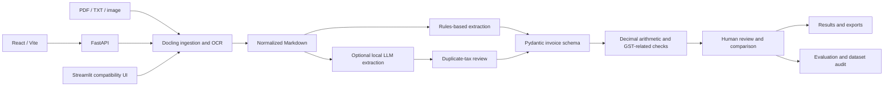

::: {align="center"}
# India Invoice AI

**Review-first invoice intelligence for extraction, arithmetic checks,
and Indian GST workflows.**

```{=html}
<p>
```
``{=html}
``{=html}
``{=html}
``{=html}
``{=html}
```{=html}
</p>
```
[Quick start](#quick-start) · [Screenshots](#screenshots) ·
[Architecture](#architecture) · [Evaluation](#evaluation) · [API](#api)
· [Documentation](#documentation)
:::

India Invoice AI is a local-first document-processing project for
extracting invoice data, checking arithmetic, reviewing tax allocations,
and keeping uncertain fields visible to a human reviewer.

It combines a deterministic rules baseline with an optional
OpenAI-compatible local LLM path, a shared Pydantic schema,
Decimal-based validation, conservative duplicate-tax review, and
explicit review states. **It is a review aid, not a GST compliance
certification system.**

## At a glance

-   **Ingest:** PDFs, text files, and supported image formats through
    the document ingestion/OCR path.
-   **Extract:** Normalize document content and extract structured
    invoice fields and line items.
-   **Validate:** Check required fields, arithmetic consistency, and
    supported GST-related signals.
-   **Review:** Preserve source values, surface missing evidence, and
    record tax-review corrections.
-   **Compare:** Separate missing values, substantive differences, and
    formatting-only differences.
-   **Evaluate:** Audit datasets and report what the evidence does---and
    does not---establish.

## Screenshots

These screenshots show the local application interface. Operational
figures and example invoice values should be interpreted according to
the labels and source reports in the application; demo or audit data is
not a claim of real-world accuracy.

### Overview dashboard


### Invoice workspace

Inspect extracted fields, line items, totals, and validation warnings
before relying on the output.


### Human review center

Missing evidence, arithmetic concerns, and unsupported tax allocations
remain visible for review.


### Extractor comparison

Compare rules-based and LLM outputs while keeping missing fields and
formatting differences separate from substantive mismatches.


### Batch processing

Review per-document status, totals, processing time, and batch export
results.


### Evaluation lab

Inspect dataset audit results without confusing structural parsing with
verified accuracy.


### System health

Inspect local backend connectivity and runtime configuration.


## What works today

  -----------------------------------------------------------------------
  Capability                          Status / boundary
  ----------------------------------- -----------------------------------
  PDF and TXT ingestion               Implemented in the shared ingestion
                                      pipeline

  PNG, JPEG, WebP, TIFF, and BMP      Supported where the installed
  ingestion                           Docling/OCR path can decode the
                                      image; OCR quality depends on image
                                      and model conditions

  OCR to normalized Markdown          Implemented with Docling and
                                      RapidOCR in the tested local setup

  Rules-based invoice extraction      Implemented

  Optional local LLM extraction       Experimental and dependent on a
                                      reachable compatible model endpoint

  Arithmetic and GST-related          Conservative checks; arithmetic
  validation                          reconciliation does not prove tax
                                      correctness

  Duplicate invoice-level tax review  Clears specific duplicated
                                      line-level tax patterns, preserves
                                      invoice totals, and records
                                      warnings

  Correction history and review       Available through the workflow and
  warnings                            review UI

  Rules-versus-LLM comparison         Implemented; agreement does not
                                      establish correctness

  Batch processing                    Implemented with per-document
                                      results and isolated failures

  FastAPI service                     Provides processing, batch,
                                      comparison, health, and evaluation
                                      endpoints

  React/Vite interface                Primary UI; use live API mode for
                                      real processing and treat any demo
                                      fallback as demo data

  Streamlit interface                 Compatibility interface remains
                                      available

  Public dataset auditing             Audit scripts produce structured
                                      reports; public parser output is
                                      not ground truth
  -----------------------------------------------------------------------

## Quick start

### Prerequisites

-   macOS/Linux or another supported Python environment
-   Python 3.12 for the tested local path
-   Node.js and npm for the React frontend
-   Optional: Ollama or another compatible endpoint for LLM extraction
-   Docker Desktop only if using Docker Compose

### 1. Set up Python

From the repository root:

``` bash
python3.12 -m venv .venv
.venv/bin/pip install -r requirements.txt
cp .env.example .env
```

No cloud credentials are required for the rules-based workflow. The
first image conversion may initialize or download local OCR/model
assets.

### 2. Start the API

In Terminal 1, from the repository root:

``` bash
.venv/bin/uvicorn api:app --reload --port 8000
```

Check health:

``` bash
curl http://localhost:8000/api/health
```

### 3. Start the React frontend

In Terminal 2:

``` bash
cd frontend
npm install
npm run dev
```

Open <http://localhost:5173>.

For actual invoice processing, confirm the frontend is connected to the
running API. If the API is unavailable and the interface shows a demo
snapshot, treat those values as demonstration data rather than live
inference.

### 4. Or run the Streamlit compatibility app

From the repository root:

``` bash
.venv/bin/streamlit run app.py
```

Use the sample PDFs under `data/samples/` or upload a supported document
through the UI.

## Common workflows

### Process one invoice through the API

``` bash
curl -X POST "http://localhost:8000/api/process?engine=rules-based" \
  -F "file=@data/samples/INV-003.pdf"
```

The API response is structured output from the configured workflow.
Review the status and warnings rather than assuming that a successful
response proves every field is correct.

### Process a batch

Use the batch endpoint:

``` text
POST /api/batch?engine=rules-based|llm
```

Submit multiple files as multipart form data. Check the API
implementation for the exact field name and configured limits before
integrating a client.

### Compare extraction engines

Use:

``` text
POST /api/compare
```

Comparison requires the relevant extraction paths and model endpoint to
be available. If local LLM inference is unavailable, the application
should report that failure rather than treating demo values as a real
comparison.

## Architecture



### Main modules

  ------------------------------------------------------------------------
  Module                               Responsibility
  ------------------------------------ -----------------------------------
  `src/invoice_ai/ingestion.py`        Validates files and converts
                                       supported documents/images to
                                       normalized content

  `src/invoice_ai/extraction.py`       Rules-based extraction from
                                       normalized content

  `src/invoice_ai/llm_extraction.py`   Optional extraction through a
                                       compatible local LLM endpoint

  `src/invoice_ai/schemas.py`          Typed invoice and line-item schema

  `src/invoice_ai/validation.py`       Required-field, arithmetic, and
                                       supported GST-related checks

  `src/invoice_ai/tax_review.py`       Conservative handling of suspicious
                                       duplicated line-level tax amounts

  `src/invoice_ai/comparison.py`       Compares outputs and separates
                                       missing, substantive, and
                                       formatting differences

  `src/invoice_ai/workflow.py`         Shared orchestration and processing
                                       metadata

  `api.py`                             FastAPI service boundary

  `app.py`                             Streamlit compatibility interface

  `frontend/`                          React, TypeScript, and Vite
                                       application

  `scripts/`                           Benchmarking, dataset auditing, and
                                       evaluation utilities

  `tests/`                             Unit and regression tests
  ------------------------------------------------------------------------

## Tax review and safety boundaries

Invoice totals and line-item tax allocation are different questions. If
the document presents a tax total at invoice level and the extraction
engine duplicates that amount onto every line item, the review layer can
clear the unsupported line-level values while preserving the
invoice-level totals and recording a warning.

The system deliberately avoids inferring CGST, SGST, IGST, GST rates,
GSTINs, or HSN/SAC codes without sufficient evidence. A mathematically
reconciled grand total does not prove that a tax rate or allocation is
legally or factually correct.

Use human review before relying on extracted values for accounting, tax
filing, payment, or compliance decisions.

## Evaluation

Evaluation is separated into synthetic regression tests and audits of
public parser data. These sources answer different questions.

  -----------------------------------------------------------------------
  Evidence                Reported result         What it means
  ----------------------- ----------------------- -----------------------
  Synthetic batch         56/56 fields across 3   Regression evidence for
  regression              fixtures                constructed fixtures,
                                                  not real-world accuracy

  Generated synthetic     60 documents; 660/660   Deterministic synthetic
  benchmark               scalar fields; 180/180  benchmark; not a
                          line items;             real-invoice accuracy
                          precision/recall/F1 =   estimate
                          1.0                     

  Synthetic baseline      20/20 fields on one     Single-fixture smoke
                          fixture                 test only

  Public saved dataset    1,348 records; 1,343    Structural audit of
  audit                   parsed responses        parser responses, not
                                                  verified invoice ground
                                                  truth

  Public audit review     1,331/1,348 records     Indicates unresolved
  rate                    marked for manual       evidence in this audit,
                          review                  not model accuracy

  Public audit arithmetic 1,326 failure records;  Generic tax/adjustment
  checks                  2,686 skipped checks    semantics and source
                                                  labels require careful
                                                  interpretation

  INV-003 comparison      34 fields, 0            Comparator behavior on
  regression              substantive             a regression fixture,
                          differences, 7          not proof that either
                          formatting-only         extractor is correct
                          differences             
  -----------------------------------------------------------------------

See `evaluation/` for the corresponding machine-readable reports.
Confirm the reports are current before quoting these values in
presentations or external material.

The public parser data does not provide trustworthy Indian GST-specific
ground truth for all relevant fields. Line-item precision/recall on
authorized real invoices, language-level accuracy, and real-world
accuracy are **not yet measured**.

### Reproduce checks

From the repository root:

``` bash
.venv/bin/pytest -q
.venv/bin/python scripts/run_extraction.py
.venv/bin/python scripts/benchmark_pipeline.py
.venv/bin/python scripts/generate_synthetic_benchmark.py --count 60 --seed 20261015
.venv/bin/python scripts/audit_dataset.py data/datasets/public/msduck_invoice_dataset
.venv/bin/python scripts/audit_dataset.py --dataset-name finvix/invoice
```

The local benchmark previously recorded warm timings of 0.58 s for
`INV-001`, 0.45 s for `INV-002`, and 0.49 s for `INV-003`, with a 0.49 s
overall warm median. These are local rules-pipeline timings on three
sample PDFs, not hosted performance guarantees or LLM latency results.

## API reference

The implemented service exposes these routes:

  ----------------------------------------------------------------------------------------
  Method                  Endpoint                                 Purpose
  ----------------------- ---------------------------------------- -----------------------
  `GET`                   `/api/health`                            Health status

  `POST`                  `/api/process?engine=rules-based\|llm`   Process one invoice

  `POST`                  `/api/batch?engine=rules-based\|llm`     Process multiple
                                                                   invoices

  `POST`                  `/api/compare`                           Compare extraction
                                                                   outputs

  `GET`                   `/api/evaluation`                        Read stored evaluation
                                                                   information
  ----------------------------------------------------------------------------------------

Interactive API documentation is available at `/docs` while the FastAPI
service is running, if enabled by the current configuration.

Uploads are bounded by `MAX_UPLOAD_BYTES`, and batches by
`MAX_BATCH_FILES`. Check `.env.example` and `api.py` for current
configuration names and defaults.

## Docker

Docker Compose configuration is provided, but container execution has
not been verified in the documented environment because the Docker
daemon was unavailable.

``` bash
cp .env.example .env
docker compose config
docker compose up --build
```

If the containers start successfully, open <http://localhost:8080>. The
frontend Nginx container is configured to proxy `/api/` to FastAPI.
Ollama is not bundled in the application containers; configure the model
endpoint and model name using the variables documented in
`.env.example`.

## Privacy, security, and data provenance

-   Do not commit private invoices, credentials, API keys, or model
    weights.
-   Invoice content and source Markdown should not be placed in logs or
    public reports.
-   Use a permitted local LLM endpoint when invoice content must remain
    local.
-   Dataset host labels do not automatically establish permission to
    redistribute source documents or use them for training.
-   Keep unredacted customer invoices outside the repository and use
    synthetic or appropriately authorized, redacted data for evaluation.
-   Review `.gitignore` and the dataset licence/provenance before
    publishing the repository.

## Known limitations

-   OCR quality depends on document quality, rotation, handwriting,
    layout, and local OCR/model availability.
-   LLM extraction is optional and depends on the configured endpoint
    being reachable.
-   Arithmetic reconciliation does not prove tax-rate or line-level tax
    correctness.
-   Public parser responses are not equivalent to labelled ground truth.
-   The React interface may show a clearly labelled demo snapshot when
    the API is unavailable; confirm live API status before capturing
    workflow evidence.
-   Docker configuration has been provided, but container execution must
    be verified in an environment with a working Docker daemon.
-   No real customer invoices should be used in public screenshots. See
    `docs/DEMO_SCRIPT.md` for a safe demo workflow.

## Documentation

-   [Architecture](docs/ARCHITECTURE.md)
-   [Evaluation methodology and limitations](docs/EVALUATION.md)
-   [Technical write-up](docs/TECHNICAL_WRITEUP.md)
-   [Demo script](docs/DEMO_SCRIPT.md)

## Roadmap

-   Add authenticated, durable review history.
-   Preserve document-layout coordinates for source-level evidence.
-   Evaluate on permitted, redacted real invoices with trusted labels.
-   Add vendor/template-group-aware evaluation splits.
-   Add asynchronous jobs for larger batches.
-   Expand browser-level end-to-end tests against a running API.

## Contributing

Before submitting a change, run the relevant checks:

``` bash
.venv/bin/pytest -q
cd frontend
npm test
npm run typecheck
npm run build
```

Keep synthetic tests separate from real-world claims, preserve privacy
boundaries, and add regression tests for behavior changes. Do not commit
credentials, private invoices, downloaded model weights, or unreviewed
datasets.

## License

No license file was present in the inspected project information. Until
a license is added, do not assume that the repository's source code or
datasets are licensed for unrestricted reuse.
