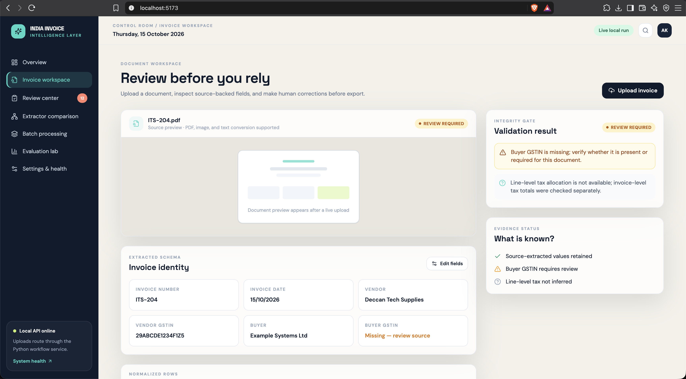
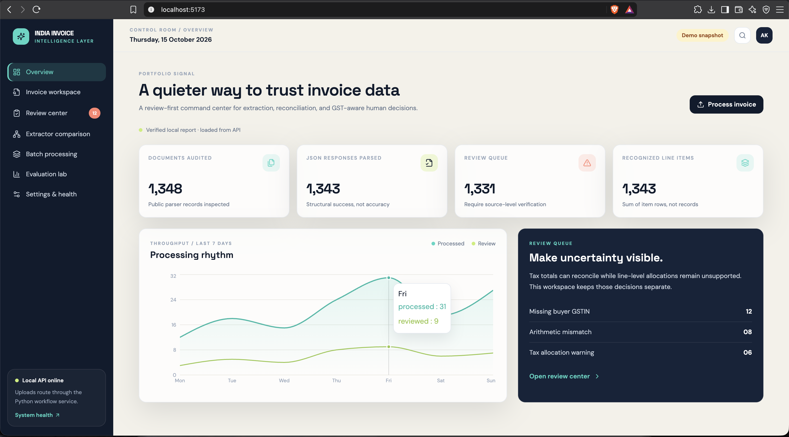
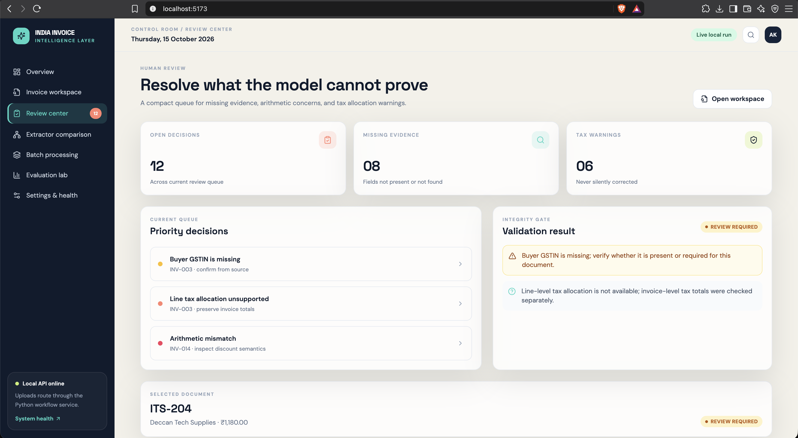
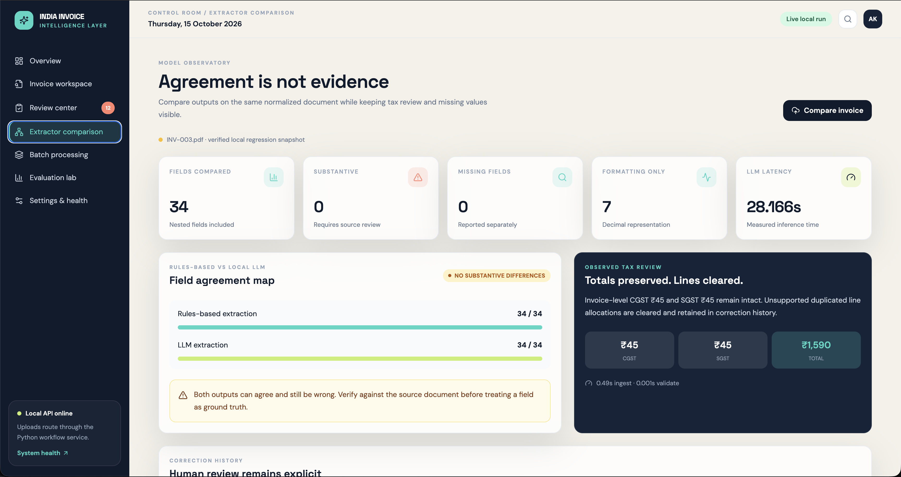
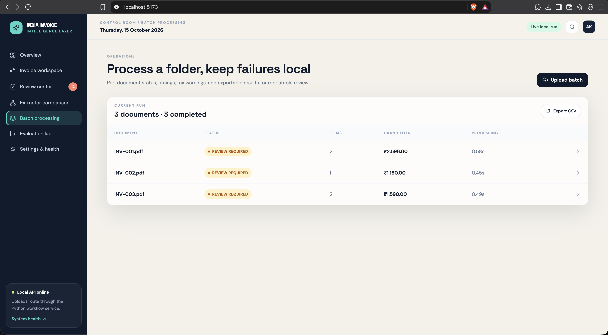
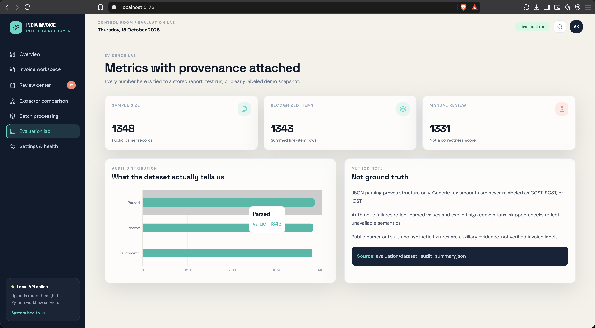
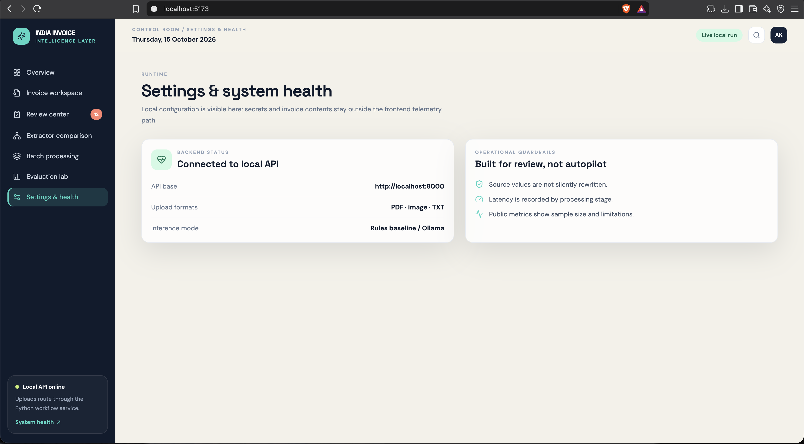
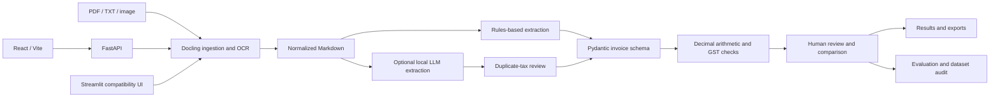

<div align="center">

# India Invoice AI

**Review-first invoice intelligence: extraction, arithmetic checks, and GST-aware human review.**


[Quick start](#quick-start) · [Screenshots](#screenshots) · [Architecture](#architecture) · [Evaluation](#evaluation) · [API](#api) · [Docs](#documentation)



</div>

> A local-first system that keeps **extraction, validation, tax review, and human judgment separate**.
> It is a review aid, **not** a GST compliance certification tool, and it never treats parser output as ground truth.

## Why this exists

Invoice automation is easy to demo and hard to trust. Valid JSON can hide wrong totals, duplicated line-level tax, missing GST evidence, and OCR errors. India Invoice AI is built so those failure modes stay visible instead of being silently "fixed".

**Design principles**

- **Never invent values.** CGST, SGST, IGST, GST rates, GSTINs, and HSN/SAC codes are not inferred without evidence. A generic `tax_amount` is never mapped to a specific tax head.
- **Decimal arithmetic only.** All money math uses `Decimal`; reconciliation checks are explicit.
- **Reconciled does not mean correct.** A total that adds up does not prove a tax rate or allocation is right, and the system says so.
- **Humans stay in the loop.** Uncertain fields, warnings, and corrections are surfaced and recorded.

## What it does

| Stage | What happens |
|---|---|
| **Ingest** | PDF, TXT, PNG, JPEG, WebP, TIFF, BMP via Docling and RapidOCR |
| **Extract** | Deterministic rules baseline, or an optional OpenAI-compatible local LLM |
| **Validate** | Required fields, GSTIN format, arithmetic consistency, GST-related signals |
| **Tax review** | Clears strong duplicated line-level tax patterns, preserves invoice totals, records a warning |
| **Review** | Source values, missing evidence, and correction history stay visible |
| **Compare** | Rules vs LLM output, split into missing, substantive, and formatting-only differences |
| **Batch** | Per-document status and totals, with failures isolated |
| **Audit** | Scripts that audit public datasets and report what the evidence does and does not establish |

## Screenshots

Screenshots show the local interface with synthetic or demo data. They are **not** claims of real-world accuracy.

| Overview | Human review center |
|---|---|
|  |  |

| Extractor comparison | Batch processing |
|---|---|
|  |  |

| Evaluation lab | System health |
|---|---|
|  |  |

## Quick start

**Prerequisites:** Python 3.12 (tested path), Node.js and npm, optionally Ollama or another OpenAI-compatible endpoint for LLM extraction, and Docker only if you use Compose.

### 1. Python environment

```bash
git clone <your-repository-url>
cd india-invoice-ai
python3.12 -m venv .venv
.venv/bin/pip install -r requirements.txt
cp .env.example .env
```

No cloud credentials are needed for the rules-based workflow. The first image conversion may download or initialize local OCR models.

### 2. Start the API

```bash
.venv/bin/uvicorn api:app --reload --port 8000
curl http://localhost:8000/api/health
```

### 3. Start the React UI

```bash
cd frontend
npm install
npm run dev
```

Open <http://localhost:5173>. If the API is unreachable, the UI shows a clearly labelled **demo snapshot**; treat those values as demonstration data, not live inference.

### 4. Or use the Streamlit app

```bash
.venv/bin/streamlit run app.py
```

### Try it

```bash
curl -X POST "http://localhost:8000/api/process?engine=rules-based" \
  -F "file=@data/samples/INV-003.pdf"
```

Always review the returned status and warnings. A successful response does not prove every field is correct.

## Architecture



| Module | Responsibility |
|---|---|
| `src/invoice_ai/ingestion.py` | File validation and conversion to normalized content |
| `src/invoice_ai/extraction.py` | Rules-based extraction |
| `src/invoice_ai/llm_extraction.py` | Optional LLM extraction via a compatible endpoint |
| `src/invoice_ai/schemas.py` | Typed Decimal invoice and line-item schema |
| `src/invoice_ai/validation.py` | Required-field, GSTIN, arithmetic, and tax checks |
| `src/invoice_ai/tax_review.py` | Conservative handling of duplicated line-level tax |
| `src/invoice_ai/comparison.py` | Extractor output comparison |
| `src/invoice_ai/workflow.py` | Shared orchestration and processing metadata |
| `api.py` / `app.py` / `frontend/` | FastAPI service, Streamlit app, React UI |
| `scripts/` | Benchmarking, dataset auditing, synthetic data generation |

## Evaluation

Evaluation separates **synthetic regression tests** from **audits of public parser data**. They answer different questions, and neither is a real-world accuracy estimate.

| Evidence | Result | How to read it |
|---|---|---|
| Generated synthetic benchmark | 60 documents; 660/660 scalar fields; 180/180 line items; F1 = 1.0 | Deterministic and generated by this project's own templates. A perfect score here shows the pipeline handles those layouts, **not** that it generalizes |
| Synthetic batch regression | 56/56 fields across 3 fixtures | Regression guard only |
| Single-fixture baseline | 20/20 fields | Smoke test |
| Public dataset audit | 1,348 records; 1,343 parsed | Structural audit of parser responses, not labels |
| Public audit review rate | 1,331/1,348 flagged for manual review | Evidence is unresolved; this is not model accuracy |
| Public audit arithmetic | 1,326 failure records; 2,686 skipped checks | Generic tax/adjustment semantics are unreliable in that data |
| INV-003 comparison regression | 34 fields, 0 substantive, 7 formatting-only differences | Comparator behavior, not correctness |

**Not yet measured:** accuracy on authorized real invoices, line-item precision/recall on real data, language-level accuracy, and LLM latency.

**Timing:** warm medians for the rules pipeline on three local sample PDFs were 0.58 s (INV-001), 0.45 s (INV-002), and 0.49 s (INV-003). These are local timings, not hosted performance claims.

Machine-readable reports are in `evaluation/`. Confirm they are current before quoting numbers externally.

### Reproduce

```bash
.venv/bin/pytest -q
.venv/bin/python scripts/run_extraction.py
.venv/bin/python scripts/benchmark_pipeline.py
.venv/bin/python scripts/generate_synthetic_benchmark.py --count 60 --seed 20261015
.venv/bin/python scripts/audit_dataset.py data/datasets/public/msduck_invoice_dataset
.venv/bin/python scripts/audit_dataset.py --dataset-name finvix/invoice
```

## API

| Method | Endpoint | Purpose |
|---|---|---|
| `GET` | `/api/health` | Health status |
| `POST` | `/api/process?engine=rules-based\|llm` | Process one invoice |
| `POST` | `/api/batch?engine=rules-based\|llm` | Process multiple invoices |
| `POST` | `/api/compare` | Compare extraction outputs |
| `GET` | `/api/evaluation` | Read stored evaluation reports |

Interactive docs are available at `/docs` while the service runs. Uploads are bounded by `MAX_UPLOAD_BYTES` and batches by `MAX_BATCH_FILES`; see `.env.example` and `api.py` for defaults and the exact multipart field names.

## Docker

Compose files are provided, but **container execution has not been verified** because no Docker daemon was available when this was written.

```bash
cp .env.example .env
docker compose config
docker compose up --build
```

If the containers start, open <http://localhost:8080>. Nginx proxies `/api/` to FastAPI. Ollama is not bundled; set the model endpoint and name in `.env`.

## Privacy and data provenance

- Invoice contents and source Markdown are kept out of logs and public reports.
- LLM use is opt-in; point it at a local endpoint when invoices must stay on your machine.
- Dataset host labels do not establish permission to redistribute or train on the source documents.
- Keep unredacted customer invoices outside the repository. Use synthetic or properly authorized, redacted data for evaluation and screenshots.
- Do not commit credentials, private invoices, or model weights.

## Known limitations

- OCR quality depends on scan quality, rotation, handwriting, layout, and local model availability.
- Reconciled arithmetic does not prove tax-rate or line-level tax correctness.
- The rules extractor has only been exercised on synthetic and sample layouts; real-world layout variety is untested.
- LLM extraction requires a reachable compatible endpoint.
- Public parser responses are not labelled ground truth.
- Docker execution is unverified.

## Roadmap

- Evaluate on permitted, redacted real invoices with trusted labels
- Compare the rules baseline, a prompted LLM, and a fine-tuned small model on one labeled set
- Vendor/template-aware evaluation splits
- Region-level source evidence from document layout coordinates
- Authenticated, durable review history
- Asynchronous jobs for large batches
- Browser-level end-to-end tests against a live API

## Documentation

- [Architecture](docs/ARCHITECTURE.md)
- [Evaluation methodology and limitations](docs/EVALUATION.md)
- [Technical write-up](docs/TECHNICAL_WRITEUP.md)
- [Demo script](docs/DEMO_SCRIPT.md)

## Contributing

Run the checks before opening a change:

```bash
.venv/bin/pytest -q
cd frontend && npm test && npm run typecheck && npm run build
```

Keep synthetic tests separate from real-world claims, preserve privacy boundaries, and add a regression test for behavior changes.

## Author & Maintainer

**Akshay Kumar Bolusani** — Software Engineer and AI/ML Developer.

India-Invoice AI is an independently developed project focused on invoice document ingestion, structured extraction, validation, and evaluation.

- **LinkedIn:** [Akshay Kumar Bolusani](https://www.linkedin.com/in/akshaykumarbolusani/)
- **Portfolio:** [akshaybolusani-portfolio.vercel.app](https://akshaybolusani-portfolio.vercel.app/)
- **GitHub:** [AkshayKumarBolusani](https://github.com/AkshayKumarBolusani)
- **Project repository:** [India-Invoice AI](https://github.com/AkshayKumarBolusani/India-Invoice)

For questions, suggestions, or collaboration, connect through LinkedIn or open an issue in the repository.

## License

MIT. See [LICENSE](LICENSE).
