# Architecture

India Invoice AI keeps document processing in Python and uses the frontend as a presentation layer.

```mermaid
flowchart LR
  Browser[React + Vite frontend] -->|multipart upload / JSON| API[FastAPI API]
  Streamlit[Existing Streamlit app] --> Workflow[Shared workflow service]
  API --> Workflow
  Workflow --> Ingest[Docling ingestion and OCR]
  Ingest --> Markdown[Normalized Markdown]
  Markdown --> Rules[Rules extractor]
  Markdown --> LLM[Optional local LLM]
  Rules --> Schema[Pydantic Invoice]
  LLM --> Review[Conservative tax review]
  Review --> Schema
  Schema --> Validate[Decimal validation]
  Validate --> Human[Review, comparison, exports]
  Human --> Reports[Audit and evaluation reports]
```

## Boundaries

- [`src/invoice_ai/workflow.py`](../src/invoice_ai/workflow.py) is the reusable application boundary.
- [`src/invoice_ai/ingestion.py`](../src/invoice_ai/ingestion.py) validates file size/integrity and routes images through Docling OCR.
- [`api.py`](../api.py) handles uploads, limits, CORS, and response shaping.
- [`app.py`](../app.py) preserves the existing Streamlit workflow.
- [`frontend/`](../frontend/) is a React/Vite interface with a clearly labelled demo fallback.
- [`Dockerfile.backend`](../Dockerfile.backend) and [`frontend/Dockerfile`](../frontend/Dockerfile) provide the local container path.

Source Markdown is retained for local review but omitted from API responses by default.
